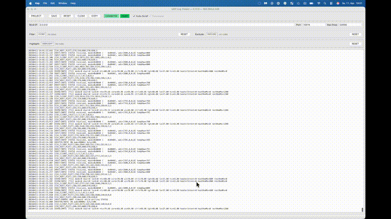
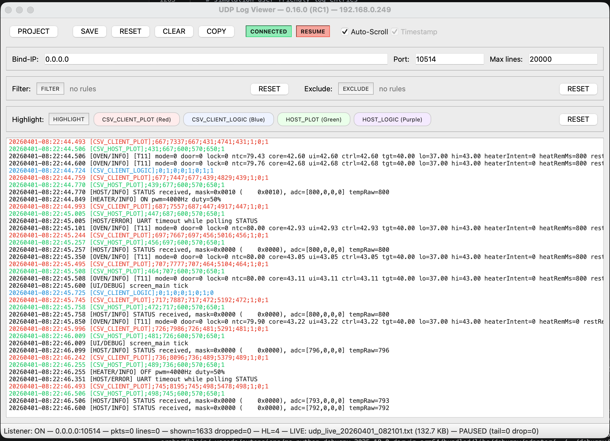
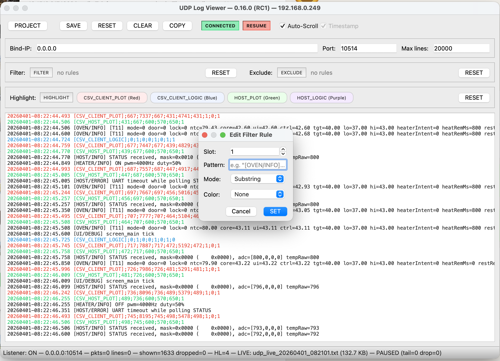
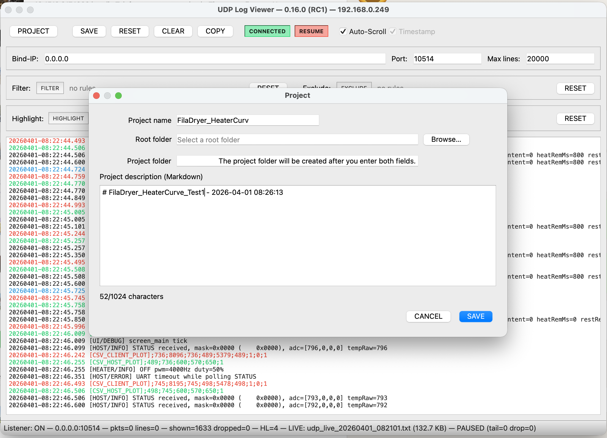
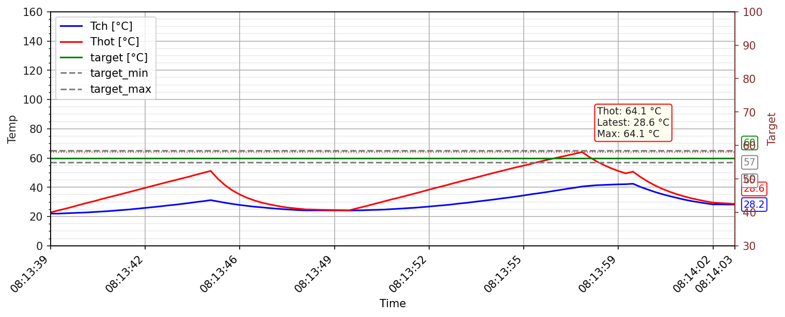
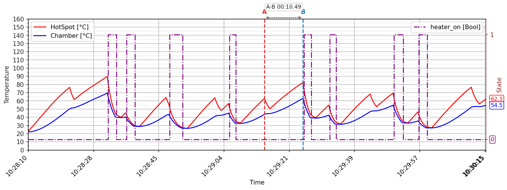
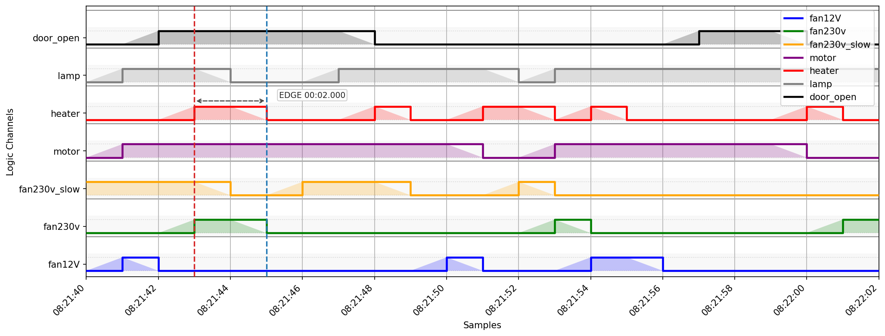
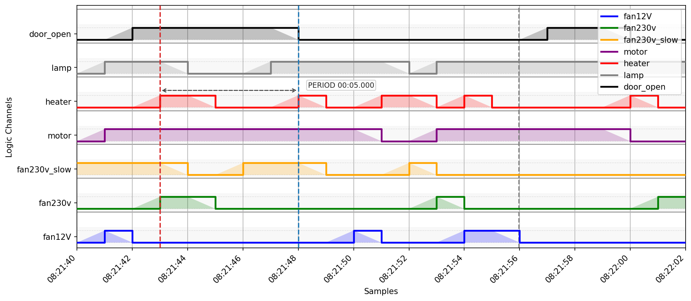

# UDP Log Viewer with Plot & Logic Analyzer for Embedded Debugging
UDP/TCP Log Viewer with integrated Plot and Logic Analyzer for embedded systems debugging (Arduino, ESP32, MCU, IoT).

Current source version: **0.18.1**. [Deutsche Anleitung](README_de.md).

- Built-in Plot Visualizer (time series data)
- Built-in Logic Analyzer (digital signals)




## Why using this tool?

Debugging embedded devices over UDP is painful.
This tool makes it simple and visual. Not only viewing data, visualizing data as well.

## Documentation

English documentation (the guides below also cover existing visualizer and project features; current transport and filter behavior is described in this README):

- [docs/DOCUMENTATION_en.md](docs/DOCUMENTATION_en.md)
- [docs/USER_GUIDE_en.md](docs/USER_GUIDE_en.md)
- [docs/CONFIGURATION_REFERENCE_en.md](docs/CONFIGURATION_REFERENCE_en.md)
- [docs/SUPPORTED_CSV_INPUT_FORMATS_en.md](docs/SUPPORTED_CSV_INPUT_FORMATS_en.md)
- [docs/RELEASE_0.17.0.md](docs/RELEASE_0.17.0.md)

German documentation:

- [docs/DOKUMENTATION_de.md](docs/DOKUMENTATION_de.md)
- [docs/USER_GUIDE_de.md](docs/USER_GUIDE_de.md)
- [docs/CONFIGURATION_REFERENCE_de.md](docs/CONFIGURATION_REFERENCE_de.md)
- [docs/SUPPORTED_CSV_INPUT_FORMATS_de.md](docs/SUPPORTED_CSV_INPUT_FORMATS_de.md)
- [docs/RELEASE_0.17.0_de.md](docs/RELEASE_0.17.0_de.md)

## HowTo use UDP on EPS32 Demo project
If you want to play around with an ESP32 & logging, please visit this demo repository
https://github.com/mrRobot62/esp-udp-logging.git

## Windows-User
please use setup.exe to install this viewer

## ToDo for MAC users
after installation this application is not signed and can't be started directly.
You have to set this command: `xattr -dr com.apple.quarantine /Applications/UDPLogViewer.app` 

## Screenshots

Screenshot assets are stored under [assets/screenshots](assets/screenshots).

### Main Screen



### Rule Configuration



### Project Dialog



### Plot Visualizer Tooltip

**Timebased visualizing**


**Measuring time**



### Logic Measurement

**Measuring HIGH/LOW phase**


**Measuring signal period**


## Current Scope

The current codebase includes:

- real-time UDP reception and a single-client TCP log server
- optional UDP discovery for compatible TCP senders
- filter and exclude rules with independent AND/OR selection, plus highlight rules
- live session logging
- main-window `RESET` support to start a fresh log phase inside the same app session
- runtime project contexts for grouping logs and screenshots per test session
- project descriptions stored as `README_<projectname>.md` inside the project folder
- replay of saved log files
- built-in simulation for text, temperature, and logic traffic
- CSV-based data visualization
- logic-channel visualization
- visualizer color selection with 16 preset colors and HTML code `#RRGGBB`
- configurable visualizer footers with presets, placeholders, and formatting
- edge and period measurement directly inside the logic graph
- runtime `Legend` toggle in plot and logic graph windows
- keyboard-driven screenshot/save shortcuts and explicit `TAB` navigation in the main and graph windows
- macOS and Windows packaging scripts


## Receive logs over UDP or TCP

1. While disconnected, select **UDP** (default) or **TCP**, set the local **Bind-IP** and **Port** (default `10514`), then click **CONNECT**.
2. `0.0.0.0` listens on all local IPv4 interfaces. It is not a destination address for a sender. Configure the sender with the viewer computer's LAN address, or `127.0.0.1` when testing on the same computer.
3. For UDP, send datagrams to that address and port; UDP broadcast is also supported. Existing UDP senders need no TCP framing changes.
4. For TCP, the viewer is the **server** and the sender is the **client**. The status displays concrete local destination addresses and whether a sender is connected. TCP log traffic uses a direct connection, not broadcast.

TCP accepts one active sender. Additional connections are rejected without replacing it. When the sender disconnects, the server keeps listening and retains existing logs and visualizer data. Keepalive helps detect lost senders; detection time depends on the operating system and network. Disconnect before changing transport or bind settings.

### Message format and counters

- UDP retains datagram-based text processing; a final newline is not required.
- TCP requires UTF-8 messages terminated by **LF** or **CRLF**. Fragmented messages and UTF-8 characters are buffered; multiple messages in a single read are separated correctly.
- TCP messages may contain at most **1 MiB of payload**, excluding the line ending. Exceeding the limit disconnects that sender; the server remains available.
- An unfinished TCP line is discarded and reported when the connection ends. It is never combined with the next connection. Invalid UTF-8 is replaced with `U+FFFD`; blank or whitespace-only lines are ignored.
- Receive counters measure UDP **datagrams and lines**, or TCP **bytes and complete nonblank lines**, before display filtering. They do not represent the number of displayed messages.

Both transports feed the same log, filter, live-file and visualizer processing. Network work runs in a background thread. **RESET** stops the session and clears runtime data, including transient visualizer freeze/measurement states. **CLEAR** clears the displayed log without deleting the live file.

### Optional TCP server discovery

Enable **Auto server discovery** for TCP and configure the **Discovery UDP port** (default `10515`). A compatible sender can discover the TCP endpoint using UDP, then establish a normal TCP connection. Discovery is disabled by default and only replies while no TCP sender is connected. The stable **Server ID** can be copied into a compatible ESP32 client's `WIFI_LOGGING_SERVER_ID` setting.

Discovery protocol version 1 uses `ULV_DISCOVER 1 <nonce>\n` and replies with `ULV_SERVER 1 <nonce> <server_id> <tcp_port>\n`. The nonce is 16 lowercase hexadecimal characters; the sender uses the reply's source IP as the destination. Discovery failure is reported separately and does not prevent manual TCP connections.

## Filter and exclude: AND / OR

Each rule chip is a separate slot. The selector combines active slots in its own group:

| Group | Default | AND | OR |
| --- | --- | --- | --- |
| Filter (include) | AND | All slots must match | At least one slot must match |
| Exclude | OR | Hide only if all slots match | Hide if any slot matches |

Examples: Filter `ADC` **OR** `PCF` shows either kind of message; Filter `CL57TE` **AND** `bench` shows only messages containing both. Exclude `DEBUG` **OR** `Heartbeat` removes either kind; Exclude `DEBUG` **AND** `Heartbeat` removes only messages containing both terms.

Exclude takes priority over include. With no active include slots, all lines pass the include stage; with no active exclude slots, none are excluded. Multiple semicolon-separated patterns **inside one slot remain AND-linked**. Existing substring/regular-expression matching remains unchanged.

Only passing log lines are displayed and written to the live log. Visualizer processing receives lines before these filters. Changes affect subsequently processed lines; existing displayed lines and saved content are not retrospectively filtered. The rule group's **RESET** clears its slots but keeps its AND/OR selection. Highlight rules remain independent.

### Persistent settings

The application stores these selections using QSettings:

| Key | Default / meaning |
| --- | --- |
| `net/protocol` | `udp`; older settings without this key continue using UDP |
| `net/discovery_enabled` | `false` |
| `net/discovery_port` | `10515` |
| `net/server_id` | Automatically generated, persistent server identity |
| `filter/operator` | `AND` |
| `exclude/operator` | `OR` |

Missing or invalid operator values fall back to the defaults, preserving legacy behavior.

## Install & Run
- MacOSX
  - download DMG and install
  - run this `xattr -dr com.apple.quarantine /Applications/UDPLogViewer.app` 
- Windows
  - download setup.exe and run

## Run From Source
```bash
python3 -m venv .venv
source .venv/bin/activate
python -m pip install -e '.[dev]'
udp-log-viewer
```
Requires Python **3.11 or newer**. On Windows, activate with `.venv\Scripts\activate` instead.

## macOS build and version metadata

Install build dependencies into the project environment and run the root-level build script:

```bash
.venv/bin/python -m pip install cx-Freeze dmgbuild
./build_dmg.sh
```

The script explicitly uses `.venv/bin/python`, prints its path, Python version and dependency versions, and stops on errors. It writes the app/DMG build output under `build/`. An activated Conda or other shell environment does not change the selected build interpreter.

The version is maintained centrally as `__version__` in [`src/udp_log_viewer/__init__.py`](src/udp_log_viewer/__init__.py). Setuptools reads it dynamically through `pyproject.toml`; the UI derives its display version from the same metadata.
## 🧪 Testing

The automated suite is in `tests/`. From the project root:

```bash
.venv/bin/python -m pytest
```

For manual testing without an ESP32, start the viewer and connect using the matching transport, then run:

```bash
# 512 combinations of filter terms, sent as UDP broadcast
.venv/bin/python tests/udp_viewer_filter_test.py --suite matrix --broadcast

# TCP to the viewer on the same computer
.venv/bin/python tests/udp_viewer_filter_test.py --suite matrix --protocol tcp --host 127.0.0.1
```

See the [manual test guide](tests/readme_udp_viewer_filter_test.md) for parameters, fragmented TCP messages, line endings and expected displayed counts. For example, of 512 matrix messages, include `ADC OR PCF` with exclude `DEBUG OR Heartbeat` displays **96**; using exclude **AND** displays **288**. The sender's filter arguments only calculate expected results; configure the viewer's rules separately. Clear the display between runs and do not count UI status messages as test messages.


## Developer Bootstrap

```bash
./scripts/bootstrap_macos_linux.sh
```
# You like it?
⭐ If you like this project, consider giving it a star!
