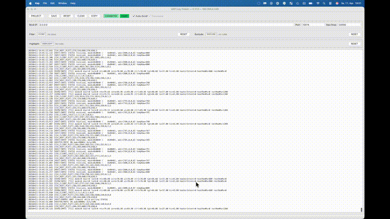
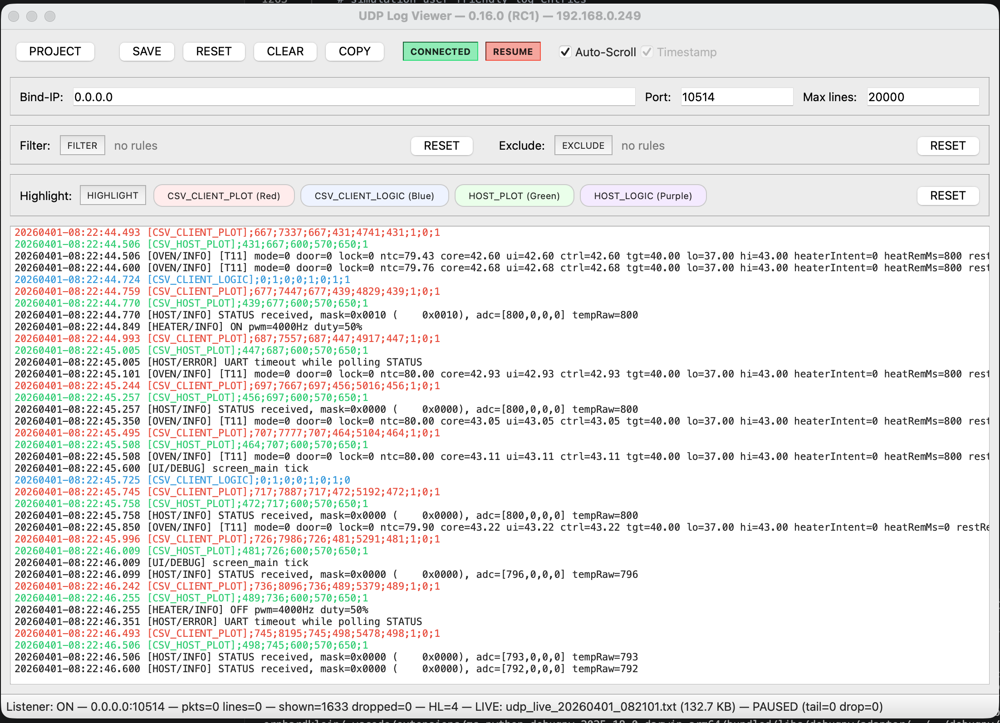
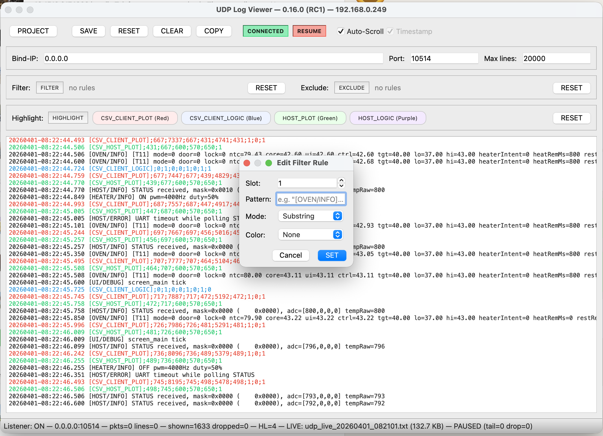
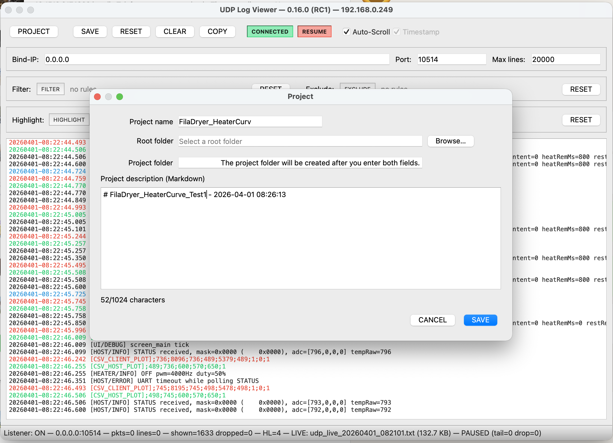
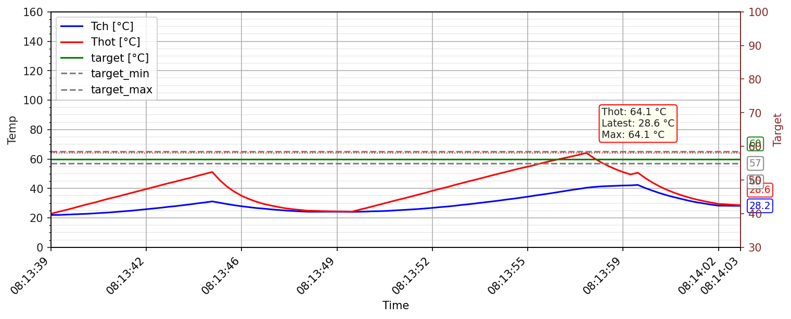
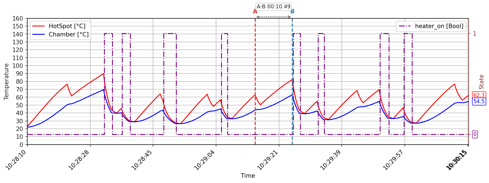
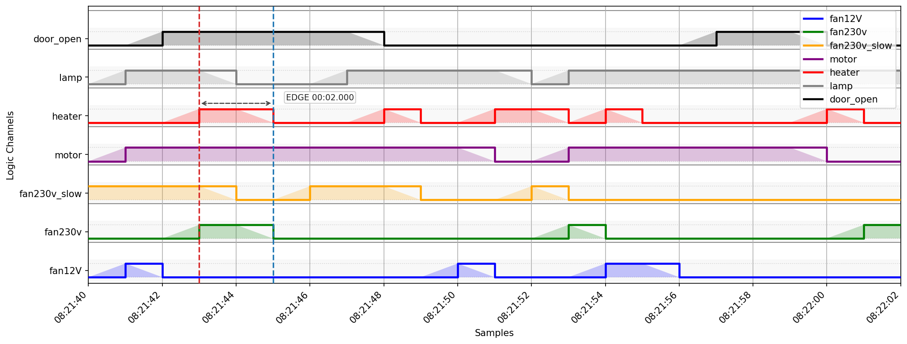
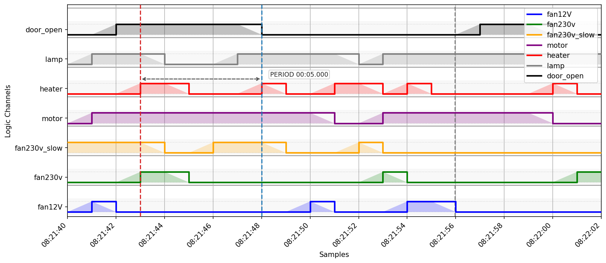

# UDP Log Viewer

Plattformübergreifender UDP/TCP Log Viewer für ESP32 und andere Embedded-Systeme, entwickelt mit Python und PyQt5.

Aktuelle Quellcodeversion: **0.18.1**. [English README](README.md).

- Integrierter Plot-Visualizer für Zeitreihen
- Integrierter Logic-Analyzer für digitale Signale



## Warum dieses Tool?

Das Debuggen von Embedded-Systemen über UDP ist mühsam.
Dieses Tool macht es einfacher und visueller. Es zeigt Daten nicht nur an, sondern visualisiert sie auch.

## Dokumentation

Deutsche Dokumentation (die verlinkten Anleitungen behandeln auch bestehende Visualizer- und Projektfunktionen; das aktuelle Transport- und Filterverhalten steht in dieser README):

- [docs/DOKUMENTATION_de.md](docs/DOKUMENTATION_de.md)
- [docs/USER_GUIDE_de.md](docs/USER_GUIDE_de.md)
- [docs/CONFIGURATION_REFERENCE_de.md](docs/CONFIGURATION_REFERENCE_de.md)
- [docs/SUPPORTED_CSV_INPUT_FORMATS_de.md](docs/SUPPORTED_CSV_INPUT_FORMATS_de.md)
- [docs/RELEASE_0.17.0_de.md](docs/RELEASE_0.17.0_de.md)

Englische Dokumentation:

- [docs/DOCUMENTATION_en.md](docs/DOCUMENTATION_en.md)
- [docs/USER_GUIDE_en.md](docs/USER_GUIDE_en.md)
- [docs/CONFIGURATION_REFERENCE_en.md](docs/CONFIGURATION_REFERENCE_en.md)
- [docs/SUPPORTED_CSV_INPUT_FORMATS_en.md](docs/SUPPORTED_CSV_INPUT_FORMATS_en.md)
- [docs/RELEASE_0.17.0.md](docs/RELEASE_0.17.0.md)

## Demo-Projekt zur UDP-Nutzung auf ESP32

Wenn du mit einem ESP32 und Logging experimentieren möchtest, findest du in diesem Demo-Repository ein passendes Beispiel:
https://github.com/mrRobot62/esp-udp-logging.git

## Windows-Nutzer

Bitte die `setup.exe` zur Installation des Viewers verwenden.

## Nur für macOS-Nutzer

Nach der Installation ist die Anwendung nicht signiert und kann nicht direkt gestartet werden.
Bitte diesen Befehl ausführen: `xattr -dr com.apple.quarantine /Applications/UDPLogViewer.app`

## Screenshots

Die Screenshot-Assets liegen unter [assets/screenshots](assets/screenshots).

### Hauptansicht



### Regel-Konfiguration



### Projekt-Dialog



### Plot-Visualizer mit Tooltip

**Zeitbasierte Visualisierung**


**Zeitmessung**



### Logic-Messung

**HIGH/LOW-Phase messen**


**Signalperiode messen**


## Aktueller Umfang

Die aktuelle Codebasis enthält:

- Echtzeit-UDP-Empfang und TCP-Logserver für einen aktiven Client
- optionale UDP-Discovery für kompatible TCP-Sender
- Filter- und Exclude-Regeln mit unabhängiger AND/OR-Auswahl sowie Highlight-Regeln
- Live-Session-Logging
- `RESET` im Hauptfenster für einen frischen Log-Start innerhalb derselben App-Session
- Laufzeit-Projektkontexte zum Gruppieren von Logs und Screenshots pro Testsession
- Projektbeschreibungen als `README_<projectname>.md` direkt im Projektordner
- Replay gespeicherter Logdateien
- integrierte Simulation für Text-, Temperatur- und Logic-Traffic
- CSV-basierte Datenvisualisierung
- Logic-Kanal-Visualisierung
- Visualizer-Farbauswahl mit 16 Preset-Farben und HTML-Code `#RRGGBB`
- konfigurierbare Visualizer-Footer mit Presets, Platzhaltern und Formatierung
- Flanken- und Periodenmessung direkt im Logic-Graphen
- Laufzeit-`Legend`-Umschaltung in Plot- und Logic-Fenstern
- tastaturgesteuerte Screenshot-/Save-Kürzel und explizite `TAB`-Navigation im Haupt- und in den Graph-Fenstern
- Packaging-Skripte für macOS und Windows

## Logs über UDP oder TCP empfangen

1. Im getrennten Zustand **UDP** (Standard) oder **TCP** auswählen, lokale **Bind-IP** und **Port** (Standard `10514`) einstellen und **CONNECT** anklicken.
2. `0.0.0.0` lauscht auf allen lokalen IPv4-Schnittstellen. Diese Adresse ist kein Sendeziel. Der Sender verwendet die LAN-Adresse des Viewer-Rechners oder `127.0.0.1` für Tests auf demselben Rechner.
3. Bei UDP Datagramme an diese Adresse und den Port senden; UDP-Broadcast wird ebenfalls unterstützt. Bestehende UDP-Sender benötigen keine TCP-Zeilenabgrenzung.
4. Bei TCP ist der Viewer der **Server**, der Sender der **Client**. Die Statusanzeige nennt konkrete lokale Zieladressen und zeigt eine Senderverbindung an. TCP-Logs werden über eine direkte Verbindung übertragen, nicht per Broadcast.

TCP erlaubt einen aktiven Sender. Weitere Verbindungen werden abgewiesen, ohne den aktiven Sender zu ersetzen. Nach einem Verbindungsabbruch lauscht der Server weiter; vorhandene Logs und Visualizer-Daten bleiben erhalten. Keepalive unterstützt die Erkennung ausgefallener Sender; die Erkennungszeit hängt von Betriebssystem und Netzwerk ab. Vor Änderungen an Protokoll oder Bind-Einstellungen zuerst trennen.

### Nachrichtenformat und Zähler

- UDP behält die datagrammbasierte Textverarbeitung bei; ein abschließender Zeilenumbruch ist nicht erforderlich.
- TCP erwartet UTF-8-Nachrichten mit **LF** oder **CRLF** als Abschluss. Teilnachrichten und fragmentierte UTF-8-Zeichen werden gepuffert; mehrere Nachrichten pro Lesevorgang werden korrekt aufgeteilt.
- Eine TCP-Nachricht darf höchstens **1 MiB Nutzdaten** ohne Zeilenabschluss enthalten. Eine Überschreitung trennt den Sender; der Server bleibt verfügbar.
- Eine unvollständige TCP-Zeile wird beim Verbindungsende verworfen und gemeldet. Sie wird nicht mit der nächsten Verbindung vermischt. Ungültiges UTF-8 wird durch `U+FFFD` ersetzt; leere oder ausschließlich aus Leerraum bestehende Zeilen werden ignoriert.
- Die Empfangszähler erfassen bei UDP **Datagramme und Zeilen**, bei TCP **Bytes und vollständige, nicht leere Zeilen**, jeweils vor den Anzeigefiltern. Sie entsprechen daher nicht der Anzahl angezeigter Nachrichten.

Beide Protokolle verwenden dieselbe Log-, Filter-, Live-Datei- und Visualizer-Verarbeitung. Die Netzwerkverarbeitung läuft in einem Hintergrundthread. **RESET** beendet die Sitzung und leert Laufzeitdaten einschließlich transienter Freeze-/Messzustände der Visualizer. **CLEAR** leert die Loganzeige, ohne die Live-Datei zu löschen.

### Optionale TCP-Server-Discovery

Für TCP **Auto server discovery** aktivieren und den **Discovery UDP port** einstellen (Standard `10515`). Ein kompatibler Sender kann darüber den TCP-Endpunkt per UDP ermitteln und anschließend eine normale TCP-Verbindung aufbauen. Discovery ist standardmäßig deaktiviert und antwortet nur ohne aktiven TCP-Sender. Die dauerhafte **Server ID** kann in die Einstellung `WIFI_LOGGING_SERVER_ID` eines kompatiblen ESP32-Clients übernommen werden.

Discovery-Protokollversion 1 verwendet `ULV_DISCOVER 1 <nonce>\n` und antwortet mit `ULV_SERVER 1 <nonce> <server_id> <tcp_port>\n`. Die Nonce besteht aus 16 hexadezimalen Kleinbuchstaben/Ziffern; die Quell-IP der Antwort dient als Zieladresse. Discovery-Fehler werden separat gemeldet und verhindern keine manuellen TCP-Verbindungen.

## Filter und Exclude: AND / OR

Jeder Regel-Chip ist ein eigener Slot. Die Auswahl verknüpft die aktiven Slots der jeweiligen Gruppe:

| Gruppe | Standard | AND | OR |
| --- | --- | --- | --- |
| Filter (Include) | AND | Alle Slots müssen zutreffen | Mindestens ein Slot muss zutreffen |
| Exclude | OR | Nur ausblenden, wenn alle Slots zutreffen | Ausblenden, sobald ein Slot zutrifft |

Beispiele: Filter `ADC` **OR** `PCF` zeigt beide Nachrichtenarten; Filter `CL57TE` **AND** `bench` zeigt nur Nachrichten mit beiden Begriffen. Exclude `DEBUG` **OR** `Heartbeat` entfernt jede dieser Nachrichtenarten; Exclude `DEBUG` **AND** `Heartbeat` entfernt nur Nachrichten, die beide Begriffe enthalten.

Exclude hat Vorrang vor Include. Ohne aktive Include-Slots passieren alle Zeilen die Include-Prüfung; ohne aktive Exclude-Slots wird nichts ausgeschlossen. Mehrere durch Semikolon getrennte Muster **innerhalb eines Slots bleiben AND-verknüpft**. Die bestehende Teiltext-/Regex-Suche bleibt erhalten.

Nur passende Logzeilen werden angezeigt und in die Live-Datei geschrieben. Die Visualizer erhalten die Zeilen vor diesen Filtern. Änderungen gelten für anschließend verarbeitete Zeilen; bereits angezeigte oder gespeicherte Inhalte werden nicht rückwirkend gefiltert. **RESET** einer Regelgruppe leert deren Slots, behält aber die AND/OR-Auswahl bei. Highlight-Regeln bleiben unabhängig.

### Persistente Einstellungen

Die Anwendung speichert diese Auswahlen über QSettings:

| Schlüssel | Standard / Bedeutung |
| --- | --- |
| `net/protocol` | `udp`; alte Einstellungen ohne diesen Schlüssel verwenden weiterhin UDP |
| `net/discovery_enabled` | `false` |
| `net/discovery_port` | `10515` |
| `net/server_id` | Automatisch erzeugte, dauerhafte Serverkennung |
| `filter/operator` | `AND` |
| `exclude/operator` | `OR` |

Fehlende oder ungültige Operatorwerte fallen auf die Standardwerte zurück und erhalten damit das bisherige Verhalten.

## Start aus dem Quellcode

```bash
python3 -m venv .venv
source .venv/bin/activate
python -m pip install -e '.[dev]'
udp-log-viewer
```

Benötigt Python **3.11 oder neuer**. Unter Windows stattdessen mit `.venv\Scripts\activate` aktivieren.

## macOS-Build und Versionsmetadaten

Build-Abhängigkeiten in der Projektumgebung installieren und das Build-Skript im Projektverzeichnis starten:

```bash
.venv/bin/python -m pip install cx-Freeze dmgbuild
./build_dmg.sh
```

Das Skript verwendet ausdrücklich `.venv/bin/python`, zeigt dessen Pfad, Python-Version und Abhängigkeitsversionen an und bricht bei Fehlern ab. App-/DMG-Buildausgaben liegen unter `build/`. Eine aktivierte Conda- oder andere Shell-Umgebung ändert den ausgewählten Build-Interpreter nicht.

Die Version wird zentral als `__version__` in [`src/udp_log_viewer/__init__.py`](src/udp_log_viewer/__init__.py) gepflegt. Setuptools liest sie dynamisch über `pyproject.toml`; die Oberfläche leitet ihre Anzeigeversion aus denselben Metadaten ab.

## Tests ohne ESP32

Die automatisierte Testsuite liegt unter `tests/`. Aufruf aus dem Projektverzeichnis:

```bash
.venv/bin/python -m pytest
```

Für manuelle Tests zuerst den Viewer mit dem passenden Protokoll verbinden und dann den Sender starten:

```bash
# 512 Kombinationen von Filterbegriffen per UDP-Broadcast senden
.venv/bin/python tests/udp_viewer_filter_test.py --suite matrix --broadcast

# TCP zum Viewer auf demselben Rechner
.venv/bin/python tests/udp_viewer_filter_test.py --suite matrix --protocol tcp --host 127.0.0.1
```

Die [manuelle Testanleitung](tests/readme_udp_viewer_filter_test.md) beschreibt Aufrufparameter, fragmentierte TCP-Nachrichten, Zeilenabschlüsse und erwartete Anzeigezahlen. Beispiel: Von 512 Matrix-Nachrichten werden mit Include `ADC OR PCF` und Exclude `DEBUG OR Heartbeat` tatsächlich **96** angezeigt; mit Exclude **AND** sind es **288**. Filterparameter des Sendeskripts berechnen nur die Erwartung; die Viewer-Regeln separat einstellen. Zwischen Testläufen die Anzeige leeren und UI-Statusmeldungen nicht als Testnachrichten mitzählen.

## Entwickler-Bootstrap

```bash
./scripts/bootstrap_macos_linux.sh
```

# Gefällt dir das Projekt?

⭐ Wenn dir das Projekt gefällt, gib ihm gerne einen Star!
